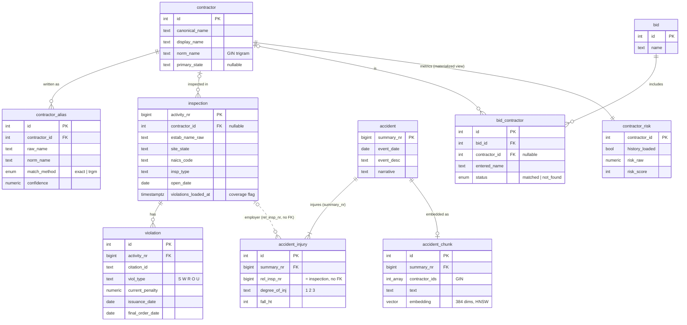

# Site Safety Intelligence

A general contractor (GC) bidding a job brings 10–15 subcontractors on site. Before signing, the GC wants to know **which subs have a worrying safety history**, and the foreman wants to **ask plain-English questions** about it from a phone on site.

This app turns messy public **OSHA enforcement data** into (1) a **risk dashboard** for the GC's bid and (2) a **tool-calling chat agent** for the foreman. Every number is computed in SQL; the LLM only reasons and retrieves narrative text — it never invents figures.

> **🔗 Live demo:** **[ssi.chatbotbenedetto.site](http://ssi.chatbotbenedetto.site/)**
>
> **Status:** fully working end-to-end on real data. One honest caveat on data volume (the public DOL API is aggressively rate-limited) is documented under [Data scoping](#data-scoping--the-rate-limit-reality).

---

## Quickstart (local)

Prereqs: Docker, Node ≥ 22, pnpm (via `corepack enable`). Copy `.env.example` → `.env` and set `API_KEY_ODP` (DOL) and `GROQ_API_KEY` (Groq).

```bash
corepack enable
pnpm install
docker compose up -d                     # Postgres + pgvector on :5433
pnpm db:migrate                           # schema + contractor_risk materialized view

# ETL (idempotent, resumable — raw pages cached under data/raw/)
pnpm --filter @ssi/api etl:inspections    # construction inspections (CA/TX/NY, ~10y)
pnpm --filter @ssi/api etl:violations     # citations
pnpm --filter @ssi/api etl:resolve        # entity resolution → canonical contractors
pnpm --filter @ssi/api etl:seed           # demo bid (violation-rich subs + a not-found sub)
pnpm --filter @ssi/api etl:enrich         # accidents/narratives for the bid + embeddings + refresh
pnpm --filter @ssi/api etl:cfr            # official 29 CFR standard text (from eCFR) → explain_standard

pnpm --filter @ssi/api dev                # API on :3001
pnpm --filter @ssi/web dev                # web on :5173 (proxies /api → :3001)
pnpm --filter @ssi/evals eval             # run the eval suite → evals/results.md
```

## Architecture

```
DOL API ──► ETL (apps/api/src/etl, CLI commands)
             │  idempotent fetch → data/raw/ (cached, resumable)
             │  clean · entity resolution · embeddings
             ▼
   Postgres + pgvector + pg_trgm
     ├─ relational: contractor, contractor_alias, inspection, violation, accident, accident_injury, bid, bid_contractor
     ├─ vectors:    accident_chunk (narrative embeddings)   ← pgvector / HNSW
     └─ MATERIALIZED VIEW contractor_risk                   ← all risk math, refreshed by ETL
             ▲ repositories (packages/db) ───────────────┐
             │                                           │ (ETL + evals reuse the same repos)
   Fastify API (apps/api)                                │
     ├─ services ──► repos ───────────────────────────┘
     │         └──► EmbeddingProvider (bge-small, local ONNX)   ← embeds the query at search time
     ├─ agent loop ──► LLMProvider (Groq)   session context: bid_id
     └─ tools (zod) ──► services            output contract: answer + citations
             ▲
   apps/web (Vite + React, mobile-first): GC risk table + add-sub + foreman chat
   evals/  ──► agent IN-PROCESS → answer accuracy + tool-call correctness + citation grounding
```

Monorepo: `packages/db` (Drizzle schema + migrations + **repositories**, shared by everything), `apps/api` (Fastify + agent + tools + ETL commands), `apps/web`, `evals`.

## Database schema & why



> Solid lines = real foreign keys. Dotted = logical link without a forced FK (`accident_injury.rel_insp_nr → inspection`). `contractor_risk` is a materialized view. `cfr_section` holds the **official 29 CFR text** for the cited construction standards (loaded verbatim from the government [eCFR API](https://www.ecfr.gov/), powering the `explain_standard` tool).

Core relational tables mirror OSHA's model; **IDs and coded fields are stored as-is** (text, no enums) so the deliberately-messy source data can never break a load.

- **`inspection`** (`activity_nr` PK) — one OSHA inspection. `contractor_id` is **nullable**, assigned *after* entity resolution. The site address is the **job site**, not the company HQ (important — see ER). `violations_loaded_at` is a **data-coverage flag** (see [Data scoping](#data-scoping--the-rate-limit-reality)).
- **`violation`** — citations, `UNIQUE(activity_nr, citation_id)` for idempotent upserts. `viol_type` ∈ S/W/R/O/U.
- **`accident`** / **`accident_injury`** — OSHA-investigated incidents. The full chain that connects "what happened" to "which company" is:

  ```
  accident ──summary_nr──► accident_injury ──rel_insp_nr──► inspection ──contractor_id──► contractor
  (what happened)          (one row per injured worker)     (inspection of that             (the firm)
                                                             worker's EMPLOYER)
  ```

  So an accident links to its injuries by **`summary_nr`** ("this injury belongs to this accident"), and each injury links to an inspection by **`rel_insp_nr`** ("this injury was investigated in this inspection" — the inspection of the injured worker's employer). An accident therefore has **no `activity_nr`** of its own, and the accident↔inspection relationship is **N:M** (one accident can trigger inspections of the GC and several subs, each with their own injured workers). `rel_insp_nr` is deliberately **not** a foreign key (a related inspection can fall outside our scope; such rows are counted and dropped). This is why a fatality is attributed to the *employer* of the worker who died, which is the fair attribution for the GC's risk view.
- **`contractor`** (canonical) + **`contractor_alias`** (every raw name variant, with `match_method` + `confidence`) — the entity-resolution output.
- **`bid`** / **`bid_contractor`** — the GC's bid. `bid_contractor.contractor_id` is **nullable** (a sub may have no OSHA record) with a **partial unique index**; `status` ∈ matched/not_found.
- **`accident_chunk`** — RAG corpus: one embedded narrative per accident, with `contractor_ids int[]` (denormalized, GIN-indexed) for filtered retrieval, `embedding vector(384)` with an **HNSW** cosine index, and `embedding_model` to detect model drift.
- **`contractor_risk`** (materialized view) — all the risk math (below), refreshed at the end of the ETL. The GC table and `get_contractor_summary` read straight from it.

Why one Postgres with pgvector: keeping vectors next to the relational data lets a single query **filter narratives by contractor** (`contractor_ids @> ARRAY[id]`) without a second datastore.

## Tools vs RAG (the key design decision)

**Numbers come from SQL tools; RAG only retrieves unstructured text.** The LLM never writes SQL and never invents counts/penalties. Typed tools (zod schemas → services):

| Tool | Returns | Source |
|---|---|---|
| `get_bid` | the bid's subs + risk | SQL |
| `search_contractor(name, state?)` | candidates + confidence | SQL (`pg_trgm`) |
| `get_contractor_summary(id)` | full risk breakdown | SQL (MV) |
| `list_violations(id, since?, type?)` | citation items (+ pending flag) | SQL |
| `compare_contractors(ids[], metric)` | ranking | SQL |
| `search_incidents(query, contractor_id?)` | accident narratives | **RAG** (pgvector) |
| `explain_standard(code)` | official 29 CFR text for a cited standard | exact lookup (eCFR) |

Every answer **cites sources** (`activity_nr` → osha.gov inspection page; incident `summary_nr`). The agent loop runs ≤ 6 iterations; tool errors **and** zod validation errors are fed back to the model so it self-corrects.

## Entity resolution (the "messy" part)

Same sub appears as "ABC Roofing Inc", "A.B.C. ROOFING LLC", "ABC ROOFING". Pipeline (in the ETL, before assigning `inspection.contractor_id`):

1. **Normalize** — uppercase, strip punctuation (acronyms kept: `A.B.C.`→`ABC`), `&`→`AND`, drop legal suffixes (INC/LLC/CO/…).
2. **Block by state** — only compare names within the same state (the address is the job site, so blocking by zip/city would split a sub that works across many sites). Trade-off: a sub working in CA *and* TX becomes two contractors — documented, and preferred over false merges.
3. **Candidate pairs** — generated in Postgres via the `pg_trgm` `%` operator on a GIN-indexed temp table (avoids O(n²) in app code).
4. **Confirm** — a pair merges only if it shares a **distinctive token** (industry words like ROOFING/CONSTRUCTION are stripped first), with **typo tolerance** (Damerau distance ≤ 1 for tokens ≥ 4 chars). So `SMITH`↔`SMTIH` merges (transposition) but `ABC`↔`ABD` does not (short acronym), and `ABC ROOFING`↔`XYZ ROOFING` never merge.
5. **Cluster + validate** — Union-Find, then a cohesion pass drops members that don't resemble the canonical (anti-chaining), and oversized clusters are flagged as *suspicious*.
6. **We deliberately do NOT use embeddings to match names** — semantic similarity ≠ identity ("ABC Roofing" and "XYZ Roofing" look similar to an embedding model). pgvector is reserved for narratives.

**Failure modes (observed):** generic names and person names over-merge (e.g. a "HIGHWAY DEPARTMENT" or "JOSE HERNANDEZ" cluster); these are the flagged suspicious clusters and are a known limitation. Prefer **split over merge** — attributing one sub's history to another is the worse error for a GC. `search_contractor` reuses the exact same normalization and searches both canonical and alias names.

## Risk score

Transparent and decomposable; computed in `contractor_risk`, never shown without its breakdown.

```
VSS = Σ_citation_items ( weight(type) × decay )           weights: W=10 R=7 S=3 O=1 U=1
HS  = Σ_injuries       ( weight(degree) × decay × citationFactor )   weights: fatality=50 hosp=15 other=3
decay(date) = 0.5 ^ (age_years / 5)                        5-year half-life (issuance/event date,
                                                            falling back to inspection open_date if null)
citationFactor = 1.0 if the injury's inspection has an S/W/R citation, else 0.3
severity_rate  = VSS / max(n_inspections, 3)               normalize by exposure (floor 3)
risk_raw       = 10 × severity_rate + HS                   harm counts in absolute terms
risk_score     = min(100, round(risk_raw))                 0–100 for display; band HIGH≥60 / MED≥25 / LOW≥1 / NONE
```

Design choices:

- **Dollar penalties are shown, but not scored.** The fine amount already reflects how serious a violation is (which the type weights capture), and it changes with settlements and appeals — so scoring it would count severity twice and compare unstable numbers. We display it as context only.
- **Citations that aren't final yet still count, but are flagged.** A citation with no `final_order_date` (e.g. one the company is contesting) is included so we don't under-report risk, but marked as *pending* since it could still be reduced or dropped.
- **The table ranks by `risk_raw` (uncapped).** The displayed score is capped at 100, so several bad subs would all show "100" and tie. Sorting by the uncapped `risk_raw` keeps the genuinely worst sub on top (e.g. one sub at raw 114 vs another at 250 — both show 100, but the second is worse).

**Where the weights come from (honest):** the inputs are real OSHA data, but the *weights are my design choice* — transparent and tunable (they live in `0001_risk_view.sql`), **not an industry standard**. Ideally they'd be calibrated against known outcomes or domain-expert input.

**Limitations (in the UI and here):** *no inspections ≠ safe* — an un-inspected sub shows "No OSHA record", never 0 risk. OSHA inspections aren't random (selection bias), so a high score can reflect scrutiny. Normalizing by inspections can flatter the rarely-inspected (e.g. a highway dept with 139 inspections and 11 serious violations scores low per-exposure).

## Data scoping & the rate-limit reality

Scope: **construction (NAICS 23), states CA/TX/NY, ~last 10 years** — chosen for variety and to fit a free deployment; the ETL is national-ready. Cleaning: dropped deleted citations (`delete_flag`), reassembled accident narratives (the `accident_abstract` endpoint returns them fragmented by `line_nr`), handled mojibake and null dates.

**Honest caveat:** the public DOL API free key is **very aggressively rate-limited** (~10–15 requests then HTTP 429 with a long cooldown; `in`-lists over ~120 ids hit a 403 URL-length cap; 10k-row pages exceed the 6 MB payload cap). Loading *every* violation/accident for 65k inspections by per-inspection requests is therefore not feasible on a free key in a sitting. The app handles this honestly:

- **~65,000 inspections** and **36,306 resolved contractors** loaded; raw pages cached so loads are idempotent/resumable.
- Violations/accidents use a **bid-first targeted** strategy: load everything for the ~12 subs actually on the bid, so the dashboard, risk scores, comparison, search and RAG all work on **real data**. The RAG corpus is thin (the enrichment trickles in as the key cools down) but the full pipeline — reassemble → embed (local `bge-small`) → HNSW retrieval filtered by contractor — is proven end-to-end (e.g. "employee run over by a truck" retrieves the real OLEAN fatality narrative at cosine 0.64).
- `etl:enrich` is resumable: re-running accumulates more accidents over time without re-fetching cached pages.

**"No data ≠ safe" is enforced in the product, not just the README.** Because only the bid's subs are loaded, the other ~36,000 contractors have zero violations loaded — their risk score is 0, which must *not* be read as "clean". So `inspection.violations_loaded_at` records whether we've actually queried a sub's citations, and `contractor_risk` exposes a `history_loaded` flag. The UI and the agent treat an un-loaded sub as **"History not loaded"**, never as low-risk or safe (exactly the error the whole design fights). This also fixes the seed's "clean" subs, which were only "zero violations *loaded*". When the GC adds a sub to the bid, the API **fires a background enrichment** of that sub's inspections (best-effort under the rate limit); the flag flips to loaded once it completes.

## Evals

`evals/` runs the agent **in-process** (not over HTTP) so it can inspect the tool-call trace. Ground-truth numbers are computed directly from SQL at run time, so they always match the loaded data. 8 cases across 7 categories — lookup, comparison, narrative/RAG, unknown-contractor, ambiguous-name, pressure-to-fabricate, out-of-scope — scored on **answer accuracy**, **tool-call correctness**, and **citation grounding** (every id the model emits must appear in a captured tool result).

Latest run (`evals/results.md`, Groq `openai/gpt-oss-120b`): **answer 100% · tool-calls 100% · grounding 100%**.

## Stack & providers

TypeScript (strict, ESM), pnpm monorepo. Postgres + pgvector + pg_trgm, Drizzle. Fastify + zod. **LLM via Groq** behind an `LLMProvider` interface (model `openai/gpt-oss-120b`; swap with `GROQ_MODEL` or a new provider — the eval suite reports `provider.name`). **Embeddings local/open** via `@huggingface/transformers` (`bge-small-en-v1.5`, 384-dim ONNX) behind an `EmbeddingProvider` interface — chosen over `fastembed-js` for Node 24 / cross-platform robustness; verified running on Node 22.

## Deploy (Dokploy)

**Live at [ssi.chatbotbenedetto.site](http://ssi.chatbotbenedetto.site/)** (self-hosted VPS, pre-seeded DB — the DOL API is unreachable from prod, so the public dataset is shipped as a seed dump).

API and web ship as Docker images (`apps/api/Dockerfile`, `apps/web/Dockerfile`), Postgres+pgvector as a Dokploy database service. `apps/web/nginx.conf` proxies `/api/ → http://api:3001/` (same Docker network). Env vars (`API_KEY_ODP`, `GROQ_API_KEY`, `DATABASE_URL`) set in Dokploy, never committed. The embedding model loads once at container boot (budget ~300–500 MB RAM) → no per-request cold start. After first deploy: `pnpm db:migrate` then the ETL commands.

## Trade-offs & with more time

- **Backfill the full violation/accident corpus** on a paid DOL key (or an overnight resumable loop) — the biggest lever: it unblocks complete risk scores and a deeper RAG demo.
- **Better handle state-plan jurisdictions.** Public-sector employers (e.g. NY highway departments) are inspected under state plans, whose records aren't in the federal OSHA search (so their citation links don't resolve) and whose codes aren't 29 CFR (e.g. the NY Industrial Code). I'd add per-state link resolution and a code parser.
- **Expand the CFR corpus** beyond the ~14 most-cited standards — the `explain_standard` tool + eCFR loader are built, it's just a bigger seed list.
- **Calibrate the risk weights.** They're transparent and tunable but hand-chosen; ideally calibrate against known outcomes or expert input, add a sensitivity analysis, and add a **NAICS-peer percentile** ("worse than 85% of roofers") for fairer comparison.
- **Data quality & retrieval:** dedup the duplicate `accident_injury` rows the API sometimes returns; add hybrid (vector + `tsvector`) retrieval.
- **Product:** auth and multi-bid support; a "retry enrichment" action for subs stuck on *History not loaded*.
- **A second LLM provider** (Claude/GPT) wired through `LLMProvider` to compare tool-calling reliability in the eval report.
