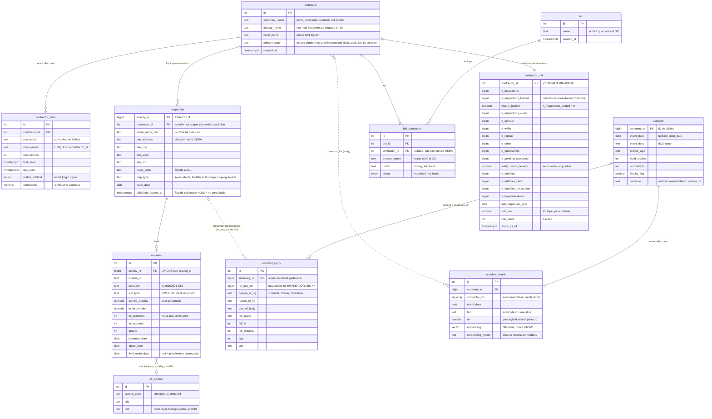

# Site Safety Intelligence: modelo de datos explicado

> Documento de estudio. Refleja **al 100%** el esquema real de la base (verificado contra Postgres).
> El diagrama Mermaid se renderiza en GitHub.

---

## 1. La idea en una frase

**OSHA registra inspecciones, no empresas.** No hay un ID de empresa: cada inspección trae el nombre escrito como vino ("ABC Roofing Inc", "A.B.C. ROOFING LLC"…). Pero el GC pregunta por **empresas**. Por eso el esquema tiene **tres capas**:

| Capa | Tablas | Para qué |
|---|---|---|
| **1. Datos de OSHA** | `inspection`, `violation`, `accident`, `accident_injury` | Los datos tal cual vienen, limpios y con las claves de OSHA, rastreables hasta la fuente |
| **2. Identidad** | `contractor`, `contractor_alias` | Resolver qué inspecciones son de la misma empresa real (entity resolution) |
| **3. Producto** | `bid`, `bid_contractor`, `accident_chunk`, `cfr_section`, `contractor_risk` (+ vista `accident_inspection`) | Lo que necesitan el GC y el foreman: su obra, la búsqueda semántica y el score |

---

## 2. Diagrama entidad-relación

Líneas **sólidas** = foreign key real. Líneas **punteadas** = relación lógica sin FK forzada (explicado en cada tabla).



**Cómo leer las patas:** `||` = exactamente uno · `|o` = cero o uno · `o{` = cero o muchos · `|{` = uno o muchos.

**Foreign keys reales (7):** `contractor_alias→contractor`, `inspection→contractor`, `violation→inspection`, `accident_injury→accident`, `bid_contractor→bid`, `bid_contractor→contractor`, `accident_chunk→accident`.
**Relaciones sin FK (a propósito):** `accident_injury.rel_insp_nr → inspection` (puede apuntar fuera del scope) y `violation.standard → cfr_section` (lookup por código).

---

## 3. Capa 1: Datos de OSHA

### `inspection`: una visita de OSHA a una obra

**Qué es:** cada vez que un inspector va a una obra se genera una inspección con un `activity_nr`. Es la tabla central: todo lo demás cuelga de acá.

**Decisiones:**
- **PK = `activity_nr` (el ID de OSHA), no un ID propio.** Cada número que mostramos es rastreable a la fuente, y `activity_nr` es también el link a osha.gov.
- **`contractor_id` nullable.** La inspección se carga *antes* de saber a qué empresa pertenece; se completa en el paso de entity resolution.
- **`estab_name_raw` se guarda tal cual.** Nunca sobreescribimos el dato original.
- **`site_address` es la dirección de la obra, no de la empresa.** Por eso *no* bloqueamos la entity resolution por zip ni ciudad.
- **`insp_type`** distingue inspecciones programadas de las motivadas por accidentes/quejas (A, M, B, H…). Clave para hablar del sesgo de selección del score, y lo usa el seed del bid para elegir subs "con historial".
- **`violations_loaded_at` — flag de cobertura.** Se setea cuando consultamos las violaciones de esa inspección a la API (devuelva o no filas). Permite distinguir *"miramos y no había"* de *"nunca la bajamos"*. Es la base del `history_loaded` del score.
- **Columnas que NO guardamos:** `insp_scope`, `owner_type`, `union_status`, `safety_const`, `nr_in_estab`, `close_case_date`, `is_state_plan`. Venían en la API pero no las usa ninguna tool, vista ni UI, así que se sacaron para no cargar ruido.

### `violation`: cada ítem citado en una inspección

**Qué es:** si en una inspección encuentran 4 problemas, hay 4 filas. Cada una con el tipo, el standard incumplido y la multa.

**Decisiones:**
- **UNIQUE `(activity_nr, citation_id)`** → ETL **idempotente** (la segunda corrida actualiza, no duplica).
- **Códigos de OSHA como `text`, no `enum`.** El dataset es "messy on purpose"; un código no documentado rompería el insert con un enum. Los enums se usan solo para valores que controlamos (`match_method`, `status`).
- **`current_penalty` + `initial_penalty`.** La multa suele bajar en el settlement; guardamos las dos y mostramos la actual.
- **Borradas (`delete_flag = 'X'`) se filtran en el ETL** (no hay columna; se dropean al cargar).
- **`final_order_date` null = pendiente/contestada.** Se cuenta en el score pero se marca (`n_pending_contested`).
- **`nr_instances` se guarda pero no puntúa:** contamos ítems de citación, no instancias.

### `accident` + `accident_injury`: el accidente y cada lesionado

**Qué es:** `accident` es el evento (qué pasó, cuándo, la narrativa). `accident_injury` tiene una fila por trabajador lesionado, con la gravedad.

**La cadena completa (importante):**
```
accident ──summary_nr──► accident_injury ──rel_insp_nr──► inspection ──contractor_id──► contractor
(qué pasó)              (cada lesionado)                 (inspección a su         (la empresa)
                                                          EMPLEADOR)
```
- `summary_nr`: "esta lesión pertenece a este accidente" (**FK real** `accident_injury → accident`).
- `rel_insp_nr`: "esta lesión se investigó en esta inspección", que es la del **empleador del lesionado** (relación lógica, **sin FK**).

**Por qué `accident` no tiene `activity_nr`:** un mismo accidente suele generar varias inspecciones (al GC, a la sub del lesionado, a la del andamio). La relación accidente↔inspección es **N:M**. Con una sola FK le cargarías todas las lesiones a una empresa.
```
Accidente #555 (caída de andamio)
 ├─ lesionado 1 (muerte)   → rel_insp_nr 1001 → inspección a "ABC Roofing"
 └─ lesionado 2 (hospital) → rel_insp_nr 1002 → inspección a "XYZ Scaffolding"
```

**Otras decisiones:**
- **`rel_insp_nr` sin FK forzada:** puede apuntar a una inspección fuera de nuestro recorte. Una FK haría fallar el insert; esas filas se cuentan y se reportan.
- **`narrative`** es el abstract reensamblado (la API lo entrega partido por `line_nr`). `event_desc` es solo el título corto.
- **`event_date` con fallback a `open_date`** de la inspección relacionada cuando viene vacía (en el cálculo del score).

---

## 4. Capa 2: Identidad (entity resolution)

### `contractor`: la empresa real

Una fila por empresa "de verdad", después de unir todas sus variantes de nombre.
- **`display_name`** = raw más frecuente (UI). **`norm_name`** = versión normalizada (búsqueda). **`canonical_name`** = el `norm_name` elegido para el cluster.
- **`primary_state` (nullable), no "dirección".** OSHA no tiene la sede: solo sabemos dónde la inspeccionaron. Llamarlo dirección sería mentir sobre los datos.
- **Índice GIN trigram sobre `norm_name`** → búsqueda difusa rápida.

### `contractor_alias`: cada forma en que apareció escrita

Una fila por variante, con cuántas veces apareció y cómo se unió.
- **UNIQUE `(contractor_id, norm_name)`**, con `occurrences`, `first_seen`, `last_seen`.
- **Dos tablas y no reescribir el nombre** porque: no destruís el crudo, es **auditable** (`match_method` ∈ `exact|trgm|typo` + `confidence`) y **reversible** (deshacés un merge sin re-bajar datos).

---

## 5. Capa 3: Producto

### `bid` + `bid_contractor`: la obra que evalúa el GC

- **`contractor_id` nullable + `entered_name` + `status`** (`matched | not_found`). El GC puede traer una sub que OSHA nunca inspeccionó → queda `not_found` y la UI muestra **"No OSHA record ≠ safe"**.
- **Unique parcial `(bid_id, contractor_id) WHERE contractor_id IS NOT NULL`:** sin duplicados, pero permite varias `not_found`.
- Es lo que conecta el sistema con el problema del cliente: con el bid, el foreman pregunta "¿cuál de *mis* subs…?" y el agente sabe de quiénes habla.

### `accident_chunk`: narrativas listas para búsqueda semántica (RAG)

Una fila por accidente con su texto (`event_desc` + `narrative`) y su embedding de 384 dims.
- **Tabla separada de `accident`:** separa el dato de OSHA del artefacto de búsqueda; cambiar de modelo = regenerar embeddings sin tocar datos. `embedding_model` avisa si se mezclaron modelos.
- **`contractor_ids int[]` con índice GIN:** por el N:M, un accidente puede involucrar a varias empresas; el array permite filtrar "narrativas de esta sub" (`@>`) sin joins. Desnormalizado → el ETL tiene orden fijo para mantenerlo.
- **`embedding vector(384)` con índice HNSW** (búsqueda global); con filtro por empresa se hace búsqueda exacta.
- **`tsv tsvector`:** reservado para hybrid search (stretch).

### `cfr_section`: el texto legal de los standards (stretch)

Secciones de 29 CFR 1926. **Lookup exacto por código** (`UNIQUE section_code`), no RAG: si ya sabés el código, no necesitás búsqueda semántica. (Tabla definida; la carga del corpus queda como stretch.)

### `contractor_risk`: vista materializada con el score

Métricas y risk score de cada empresa, precalculados en SQL. **20 columnas** (todas las del DB):

`contractor_id`, `n_inspections`, **`n_inspections_loaded`**, **`history_loaded`**, `n_inspections_clean`, `n_serious`, `n_willful`, `n_repeat`, `n_other`, `n_unclassified`, `n_pending_contested`, `total_current_penalty`, `n_fatalities`, `n_fatalities_cited`, `n_fatalities_no_citation`, `n_hospitalizations`, `last_inspection_date`, `risk_raw`, `risk_score`, `score_as_of`.

- **Materializada, no por request:** los datos solo cambian con el ETL; `REFRESH` al final. La tabla del GC carga al instante.
- **El cálculo vive en SQL, no en TS ni en el LLM:** una sola fuente de verdad. La tabla del GC y el agente leen **el mismo número**.
- **`risk_raw` sin tope + `risk_score` 0–100:** el score con tope satura (empatan en 100), por eso se ordena por `risk_raw`.
- **`history_loaded` / `n_inspections_loaded`:** cobertura de datos. Si es `false`, la UI y el agente muestran **"History not loaded"** y nunca lo tratan como seguro (un score 0 ahí significa "no cargado", no "sin violaciones").
- **`total_current_penalty` se muestra pero no puntúa** (duplicaría la severidad y depende de settlements).
- **`score_as_of`:** el decay depende de la fecha; el score es "a la fecha del último refresh".

### `accident_inspection` (vista normal)

```sql
SELECT DISTINCT summary_nr, rel_insp_nr FROM accident_injury WHERE rel_insp_nr IS NOT NULL;
```
La tabla puente accidente ↔ inspección, para consultar el N:M con comodidad.

---

## 6. Índices y por qué

| Índice | Tabla / columna | Para qué |
|---|---|---|
| GIN `gin_trgm_ops` | `contractor.norm_name`, `contractor_alias.norm_name` | Búsqueda difusa de nombres |
| HNSW `vector_cosine_ops` | `accident_chunk.embedding` | Búsqueda semántica global |
| GIN | `accident_chunk.contractor_ids` | Filtrar narrativas por empresa (`@>`) |
| GIN | `accident_chunk.tsv` | Hybrid search (stretch) |
| B-tree | `inspection.contractor_id`, `inspection.site_state`, `inspection.naics_code` | Joins/filtros frecuentes |
| B-tree | `violation.activity_nr`, `violation.viol_type` | Joins y agregados del score |
| B-tree | `accident_injury.summary_nr`, `accident_injury.rel_insp_nr` | La cadena accidente→inspección |
| UNIQUE | `violation(activity_nr, citation_id)` | Upserts idempotentes |
| UNIQUE parcial | `bid_contractor(bid_id, contractor_id) WHERE contractor_id IS NOT NULL` | Sin duplicados, permitiendo varios `not_found` |
| UNIQUE | `cfr_section(section_code)` | Lookup por código |
| UNIQUE | `contractor_risk(contractor_id)` | Necesario para `REFRESH` y lecturas por PK |

**HNSW vs IVFFlat:** IVFFlat necesita "entrenar" sus listas con datos y rinde mal con pocas filas. HNSW funciona bien desde el principio.

**Enums (los únicos del esquema):** `match_method` (`exact | trgm | typo`) y `bid_status` (`matched | not_found`). Todo lo que viene de OSHA es `text`.

---

## 7. Decisiones transversales (las que más te van a preguntar)

**¿Por qué pgvector en el mismo Postgres y no una base vectorial aparte?**
> Con este volumen, una base separada agrega infraestructura sin beneficio. Vectores y datos relacionales juntos permiten filtrar la búsqueda semántica con SQL normal ("narrativas de esta sub") en una sola query. Un solo backup, un solo deploy. Lo reevaluaría con millones de chunks.

**¿Por qué los números salen de SQL y no del RAG?**
> Si le pasás narrativas al LLM y le preguntás "¿cuántas violaciones tiene?", cuenta mal o inventa. Los números salen de tools con SQL; el RAG solo recupera texto para preguntas cualitativas.

**¿Por qué no usás embeddings para unir nombres de empresas?**
> La similitud semántica no es identidad: para un modelo, "ABC ROOFING" y "XYZ ROOFING" son casi iguales. Para nombres usamos trigram + tokens distintivos; los embeddings quedan para lo que sí es significado.

**¿Qué pasa si no bajaste los datos de una sub?**
> `violations_loaded_at` / `history_loaded` lo registran. Sin cobertura, la sub se muestra como "History not loaded", nunca como limpia. "Sin datos ≠ segura" está resuelto en el producto, no solo en el README. Al agregar una sub al bid se dispara el enrich de sus inspecciones.

**¿Qué limitaciones tiene el modelo?**
- Una empresa en varios estados puede quedar partida en dos (no unimos entre estados, para evitar falsos merges de nombres genéricos).
- Recorte a 3 estados / NAICS 23 / ~10 años: el historial fuera de eso no cuenta.
- Sin inspecciones ≠ segura (sesgo de selección: OSHA inspecciona más donde hay quejas/accidentes).

---

## 8. Recorrido de una pregunta por el esquema

*Foreman: "¿Cuál de mis subs tuvo muertes?"*
1. `bid_contractor` → los `contractor_id` de la obra.
2. `contractor_risk` → `n_fatalities` de cada uno (respetando `history_loaded`).
3. Detalle: `inspection` (por `contractor_id`) → `accident_injury` (por `rel_insp_nr`, `degree_of_inj='1'`) → `accident` (qué pasó).
4. La respuesta cita los `activity_nr` → links a osha.gov.

*Foreman: "¿Alguna tuvo caídas desde andamios?"*
1. Se embebe la pregunta → vector.
2. `accident_chunk` filtrado por `contractor_ids @> [id]`, ordenado por similitud.
3. Si supera el umbral → narrativas + `summary_nr` como cita; si no → "no relevant incidents".
